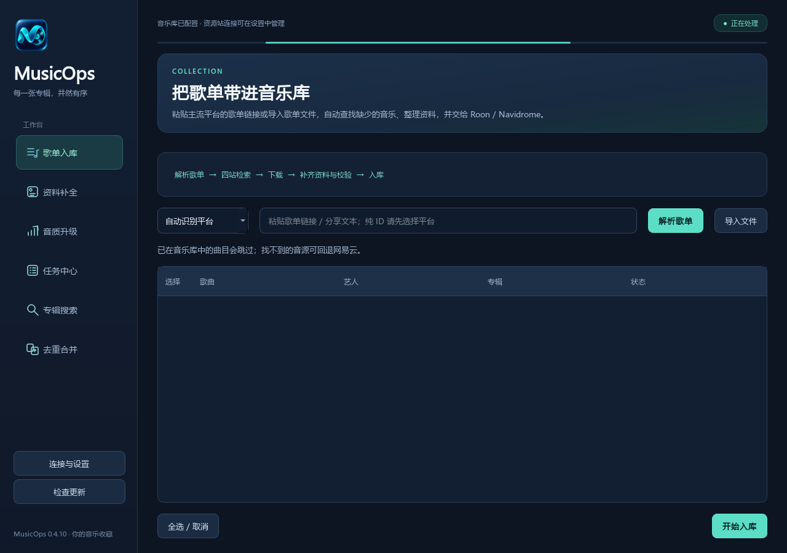
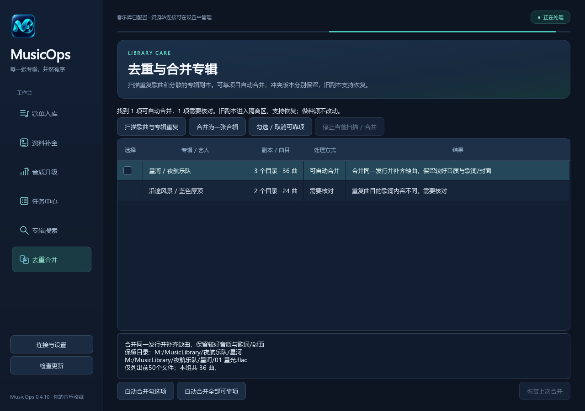
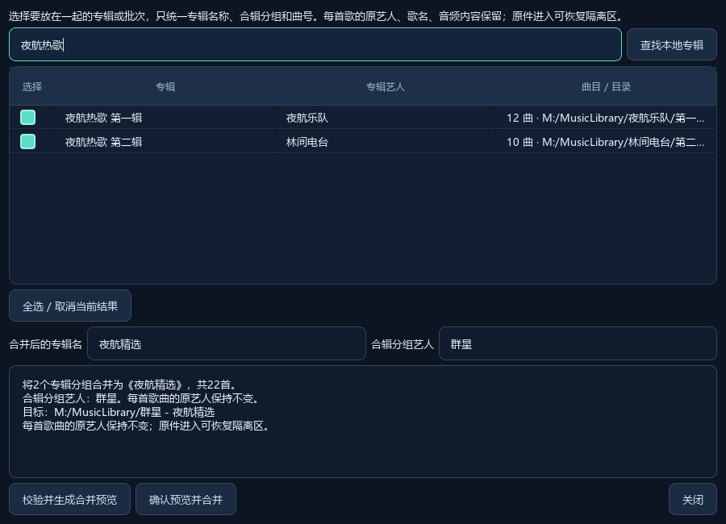
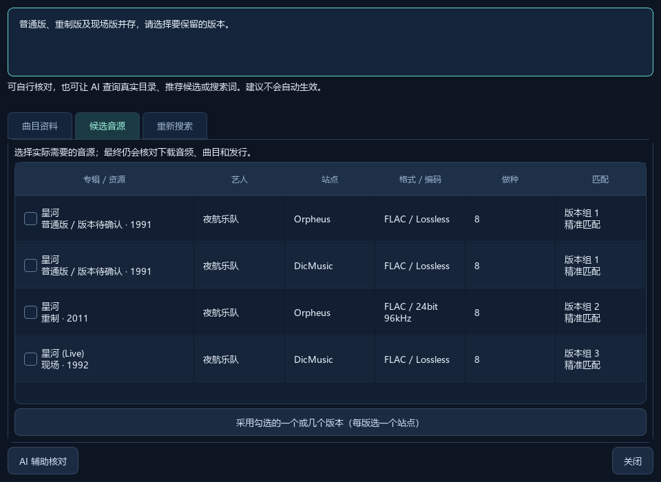
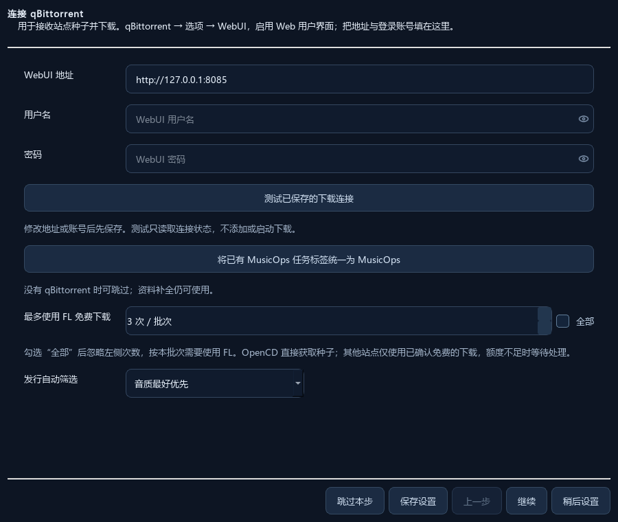
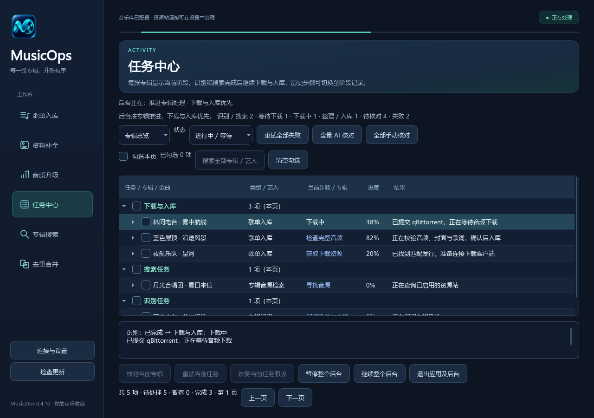
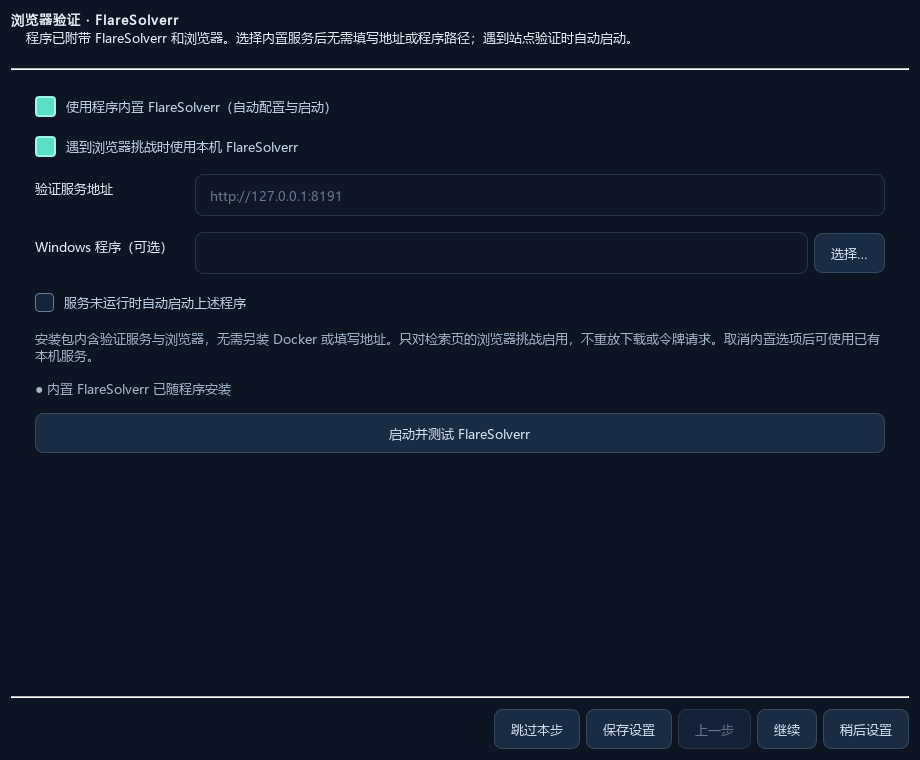
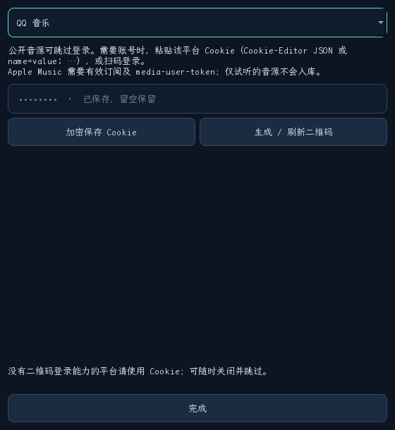
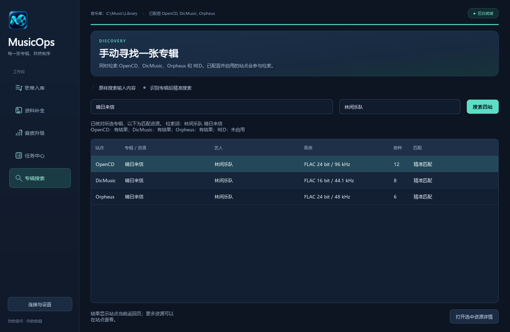
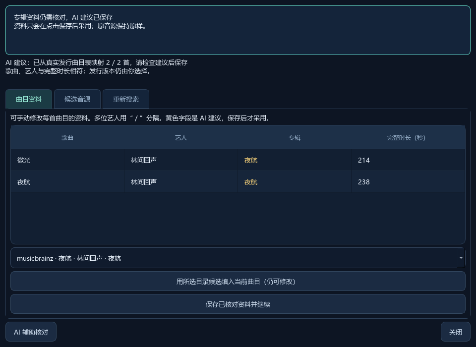

<div align="center">
  
  <h1>MusicOps</h1>
  <p><strong>从主流平台歌单到自己的音乐库，让下载、整理与升级连起来。</strong></p>
  <p>中文桌面应用 · 十个平台歌单 · 资料补全 · 音质升级 · 去重合并</p>
  <p>
    <a href="https://github.com/wsdbb72/MusicOps/releases/latest"></a>
    <a href="https://github.com/wsdbb72/MusicOps/actions/workflows/windows-tests.yml"></a>
    <a href="LICENSE"></a>
    
    
  </p>
  <p>
    <a href="https://github.com/wsdbb72/MusicOps/releases/latest"><strong>下载桌面版本</strong></a> ·
    <a href="docs/用户操作说明.md">配置与操作指南</a> ·
    <a href="docs/运维与恢复说明.md">备份与恢复</a> ·
    <a href="https://github.com/wsdbb72/MusicOps/issues">反馈问题</a>
  </p>
</div>



*界面截图使用合成音乐资料，不包含私人账号、歌单或运行档案。*

MusicOps 把日常音乐库维护收敛为三个入口：把歌单中缺少的音乐补进库、补齐已有音源的资料，以及寻找并验证更好的音源。任务在独立后台执行，进度和需要人工核对的项目集中显示。

审阅与验收范围：[代码审阅与验证](docs/代码审阅与验证.md)。

**去重合并** 页面：扫描歌曲与分散专辑副本，勾选可靠项目或一键合并全部可靠项。歌曲去重比对文件字节或完整解码后的音频内容；补齐同发行的分散曲目需要标签或人工确认资料库中的发行身份，保留较好的音源，并补齐缺失标签、歌词和封面。不同版本、声道、CUE 引用、歌词或封面冲突会列明原因；同名不会直接删除。旧副本进入可恢复隔离区，支持恢复最近一批合并，重启软件后仍可读取恢复记录。去重操作不改写做种文件。

**0.4.10：合辑与资料修复。** 在“去重合并”中选择 **合并为一张合辑**，查找并勾选原专辑，填写合并后的专辑名，先校验预览再执行。例如把多个“最新热歌慢摇”批次放进同一张合辑：每首歌的原艺人、歌名和音频保留，只有专辑名、专辑分组艺人和曲号统一；原件进入可恢复隔离区。合辑不会继承原专辑的发行 ID，避免被错误识别成某一张原专辑。仍在用于做种的库内原件会阻止合并，须先迁至独立做种目录。单次最多 500 首，不会因同名直接删歌。

发行筛选把单曲放在最低优先级。普通版与现场、重制、豪华、再发行等版本并存时进入核对页，可勾选一版或几版，同一版本分组选一个站点音源。分组展示年份、目录号和介质，属于比较线索；最终仍检查下载文件。主动保留多个版本时分别建任务和目录，已有音源保留，不把现场版当普通版升级删除。信息不足的版本保持待确认。

封面补全支持同目录的“艺人 - 专辑名.jpg”，记录选用图片的来源和摘要；同优先级的不同正面图需要核对，避免在线图片掩盖本地冲突。设置中可启用“已确认中文的资料优先简体”，日文和语言不明的名字保持原文。部分专辑可依据唯一的歌名、艺人和时长证据补齐已有曲目的资料，不会据此冒充完整发行。新入库歌曲立即刷新本地目录；歌词和封面保留事务记录，不再计入歌曲数。

下载和整理目录跟随音乐库：例如 `E:/music` 使用 `E:/MusicOps/downloads`、`work`、`seeding`。入库文件逐项校验成功后清理本任务的临时音频；PT 原始文件由 qBittorrent 迁移到永久 `seeding` 目录，保存迁移意图并核对前后文件哈希、客户端路径和做种状态。入库副本可补标签，做种原件保持字节不变，两者用途不同，不能直接删除做种原件来节省空间。历史路径异常按任务创建记录核对后迁移，不接管仅带同名标签的私人种子。

修复网易云回退任务循环引用导致的 `ValueError`。本地资料补全增加按专辑名和艺人精确匹配的封面 API，网易云封面失败后仍可尝试已确认的 MusicBrainz 发行封面。`???`、替换字符和未知艺人占位符会触发资料修复。同步歌词同时保存为同名 UTF-8 `.lrc`，并在入库副本中补写纯文本歌词标签供 Roon 导入；旁置 `.lrc` 的生成不等于 Roon 已显示同步歌词。参见 [Roon 官方歌词说明](https://help.roonlabs.com/portal/en/kb/articles/lyrics)。

修复快速切页时音质偏好文字叠到任务列表上的残影，页面使用独立不透明绘制；小窗口内可滚动，控件不再相互挤压。后台任务失败时正确恢复操作按钮。Windows 按系统报告的核心类别识别小核，对本程序及其启动的内置组件设置小核亲和性、低优先级和 EcoQoS；单处理器组使用严格亲和性，多处理器组使用系统 CPU Sets。未识别到大小核时保留系统分配并降低后台优先级。文件校验最多 4 项并行，界面请求最多 8 项，单个音频解码 1 线程；歌单匹配结果批量写入 SQLite，减少重复开库与提交。

已经下载并验证的专辑优先完成发布，再处理检索与回退下载，避免成品被搜索积压挡住。发布失败可沿用原文件事务重试，已经提交的事务不会重复入库。长目录和文件名会保留区分标记并预留原子提交临时文件所需长度，音频标签中的完整歌名、艺人和专辑名不会缩短。正常重启复用一天内更新过的本地目录数据库；歌单与维护入口仍会先做增量扫描。内置下载器的输入、输出和转码临时文件也使用音乐库同级的工作目录。



<details><summary>查看合辑预览与版本选择</summary>





</details>

**0.4.8** qBittorrent 新任务统一使用唯一标签 `MusicOps`。旧任务在安全对账时整理历史任务标签，也可在 **连接与设置 → qBittorrent → 将已有 MusicOps 任务标签统一为 MusicOps** 批量处理；仅处理有创建记录且哈希、分类和目录一致的项目，不启动下载，保留其他手动标签。



流媒体平台的专辑、歌手可能填错。正常四站匹配失败时，先尝试 **歌名＋歌手（不限制专辑）**，必要时再 **仅歌名** 查询真实目录。唯一的歌名、歌手、完整时长和发行曲目表可用于纠正专辑；歌手冲突、同名或多个发行进入 AI 身份核对，证据仍不足时保留人工选择。原始平台字段保留用于追溯。仅歌名用于寻找线索，不能凭同名直接下载或覆盖标签；正常匹配不额外调用 AI，查询和建议使用缓存。

**0.4.7** 修复下载与入库被旧识别 / 搜索队列长期压后的调度问题，优先推进已有音源的后续阶段；历史任务配置自动补齐新增字段，解决旧流媒体回退任务的 KeyError。任务中心默认按专辑合并显示当前阶段，支持切换阶段记录，识别 / 搜索完成不再当成整张专辑已入库。FlareSolverr 全部移入连接与设置，启动测试独立执行并显示等待时间和失败原因；新增已保存的 qBittorrent 下载连接测试。



**0.4.6** 修复 Windows 后台连接拥堵与 WinError 121：后台并发接收读取请求，界面合并重复刷新，大任务队列增加查询索引。任务进度原位更新，浏览列表时保留位置；继续勾选可重新排队已有明确恢复阶段的失败任务，人工资料核对仍需选择。内置 FlareSolverr 独立成设置页，侧栏可直接进入，显示组件是否安装，并可直接保存。修复 qBittorrent 连接异常提示和异常状态遗留，增加真实打包程序的并发连接验收。



**0.4.5** 内置 FlareSolverr、随包浏览器与 go-music-dl，程序自动启动和配置，无需另装服务；流媒体平台 Cookie 和扫码登录可在设置中完成。AI 支持本地专辑别名、搜索词、候选结果和失败恢复的辅助识别；待核对任务持久化排队，取消前 20 项截断，后台逐项处理。修复下拉菜单顶部和底部的白条。

修复有 FL 库存却被旧种子缓存拦住的问题：DicMusic / Orpheus 的 FL 下载统一使用 `usetoken=1`，重试时重新核验个人免费状态、实际余额和本批额度。当前已个人免费的资源直接复用；旧缓存不再免费时，核验实时 FL 按钮后重新使用令牌，历史消费记录保留。兼容数字字符串、页面令牌总量及分项库存；请求结果未知时仍先对账，不重复扣令牌。



配置入口：**连接与设置 → 浏览器验证与内置 FlareSolverr 设置 → 使用程序内置 FlareSolverr → 保存设置**；向导 **多平台流媒体回退 → 使用程序内置 go-music-dl → 平台 Cookie / 扫码登录**。没有账号的平台可以跳过；已填写的 Cookie 显示保存标识。平台服务只监听本机随机端口，由 MusicOps 管理启停，不在命令行、日志或引擎数据库中保存明文 Cookie。

AI 优先复用目录、本地索引和缓存；遇到常规匹配失败时自动登记后台核对队列。关闭窗口后继续处理，重启后台可恢复；同一问题版本只处理一次，搜索结果或资料变化后才会再次评估，单个任务最多自动推进三轮，仍有歧义时留待手动核对。曲目别名按小批次比较，已匹配的曲目不重复发送。接口没有联网工具时仍可使用普通 AI 提供别名搜索词，再核实真实目录；AI 建议不会绕过完整音频、时长和事务校验。令牌不足时是否允许普通下载，始终由用户在专用提示中选择。

**0.4.4** 收紧 DicMusic / Orpheus 的 FL 默认策略，修复 DicMusic 个人免费误判；支持仅一次或仅本批次的普通下载授权。任务中心增加状态筛选、全量失败重试、全量 AI 核对与保存后自动下一张的连续手动核对，刷新保留滚动位置。增加音质 / 曲目最全 / 特殊版本筛选、库内整专辑缺曲补全，以及 go-music-dl 多平台最终回退。

**0.4.3** 增加删除任务记录、单选与批量失败重试、可编辑的核对窗口、真实目录支持的 AI 辅助建议，以及持久化本地专辑资料库。安装版启动时会检查 GitHub 新版，自动下载并校验当前系统安装包，后台安全退出后启动更新向导。此后 Mac 只发布 Apple Silicon ARM 版；历史 Intel 附件保留。

支持网易云、QQ 音乐、汽水、酷狗、酷我、咪咕、bilibili、Apple Music、Spotify、YouTube Music 的歌单链接识别，以及 JSON / CSV / TSV / TXT / M3U8 / XLSX 文件导入。**链接能识别，不代表每个平台都能在未登录时完整读取**；具体入口、授权与完整性边界见下方支持表。

下载来自已配置的 OpenCD、DicMusic、Orpheus、Redacted；启用的站点在当前完整结果范围内均没有匹配资源时，可按设置回退流媒体；失败或未读完的结果先等待核对。完成整理和音频验证后，再把文件交给 Roon / Navidrome 读取。

## 目录

- [先下载并运行](#先下载并运行)
- [歌单平台与文件格式](#歌单平台与文件格式)
- [第一次使用：七步配置](#第一次使用七步配置)
- [三个工作流怎么用](#三个工作流怎么用)
- [本地专辑资料库](#本地专辑资料库)
- [手动搜索四站专辑](#手动搜索四站专辑)
- [任务中心与常见问题](#任务中心与常见问题)
- [资料识别与音质判断](#资料识别与音质判断)
- [目录、更新与隐私](#目录更新与隐私)
- [开发、验证与贡献](#开发验证与贡献)

## 先下载并运行

在 [最新 Release](https://github.com/wsdbb72/MusicOps/releases/latest) 的 **Assets** 中选择。以实际上传的资产和构建结果为准：

| 文件 | 用途 | 使用方式 |
| --- | --- | --- |
| `MusicOps-版本号-Setup.exe` | 推荐，常规安装 / 更新 | 先检测已有版本，找到后更新原目录；首次使用按向导安装 |
| `MusicOps-版本号-Windows.zip` | 绿色文件夹版 | 完整解压到可写目录，双击 `MusicOps.exe` |
| `MusicOps-版本号-macOS-arm64.pkg` | Apple Silicon Mac，推荐 | 双击运行安装向导，安装到“应用程序” |
| `MusicOps-版本号-macOS-arm64.zip` | Mac 手动安装版 | 解压，将 `MusicOps.app` 拖入“应用程序” |
| `MusicOps-版本号-source.zip` | 开发用源码 | 普通使用无需下载 |
| `SHA256SUMS` / `SHA512SUMS` | 下载完整性核对 | 对照同一 Release 中对应文件的校验值 |

Windows 运行环境为 **Windows 10 / 11 64 位**；macOS 构建目标为 **macOS 15 及以上**，仅构建 Apple Silicon `arm64`，不承诺兼容旧系统；历史 Intel 版本保留在各自 Release 中。桌面发行包无需安装 Python。Windows 绿色版需要保留整个文件夹，尤其是 `_internal`，不能只取出一个 EXE。

Windows 安装器优先查找已有安装；检测到后会显示旧版本和原目录，执行更新并保留 `profile`、已保存的凭据、任务和 `tools`。未找到时才进入全新安装。以前使用绿色版且未被自动找到时，在目录页选择原 MusicOps 文件夹即可识别为更新；不要另选一个空目录来覆盖原档案。安装器会拦截已知的降级安装。更新前先在任务中心点击 **退出应用及后台**；正在运行的任务需等待完成，或自行取消并到达安全阶段后再退出。

**自动更新**默认开启，可在“连接与设置”的软件更新选项关闭。正常启动安装版时检查官方 GitHub 最新正式版，自动下载当前系统的 `Setup.exe` 或 ARM Mac `.pkg`，核对服务器 SHA-256 后等待后台安全退出，再打开系统安装向导；按向导完成即可。侧栏“检查更新”可手动重试。网络失败不影响使用，下载不完整、哈希不符或没有适配包时不会启动安装。源码及自动验收启动不会触发自动安装。

macOS 的 `.pkg` 是原生安装向导，安装到 `/Applications/MusicOps.app`，无需手动拖放。升级前在“任务中心”点击 **退出应用及后台**；运行中的任务会阻止退出和安装替换。旧版没有此按钮时，确认任务已停止后，在“活动监视器”退出 MusicOps 和 MusicOps-worker 再安装。个人资料和钥匙串凭据保留；安装器不会以管理员身份启动应用。

Mac 安装包和 ZIP 附带对应 `.sha256`、`.sha512` 和 `-build.json`，由 GitHub Actions 在对应架构机器构建并实际安装、重复安装及运行验收。当前 `.app` 仅有 ad-hoc 完整性签名，`.pkg` 未使用 Developer ID Installer 签名，也没有 Apple 公证，Gatekeeper 可能拦截。确认下载来源与校验值后，可按系统提示在 **系统设置 → 隐私与安全** 中选择“仍要打开”；不要关闭系统安全功能。[Apple 官方说明](https://support.apple.com/en-us/102445)。CI 验收不代表所有私人音乐服务均已现场实测。

完整音频验证需要 **FFmpeg 和 ffprobe**。公开包不附带这两个程序，可从 [FFmpeg 官方下载页](https://ffmpeg.org/download.html) 获取适合自己系统的构建，解压后在向导中分别选择 `ffmpeg`、`ffprobe` 可执行程序（Windows 对应 `.exe`）。已有工具可以继续使用。

首次打开会进入设置向导；没有的账号或服务可以跳过，以后点击 **连接与设置** 补充。

<details>
<summary>想校验下载的安装包？</summary>

在下载目录打开 PowerShell，运行：

```powershell
Get-FileHash -LiteralPath .\MusicOps-版本号-Setup.exe -Algorithm SHA256
```

将结果与同一 Release 的 `SHA256SUMS` 对照。把命令中的“版本号”替换为实际文件名。

</details>

## 歌单平台与文件格式

### 在线解析支持表

下表描述当前读取能力。只有来源给出的总数、实际条目与完整分页相互吻合时，才将清单标为完整；预览、受限、失效条目或缺失资料会保留明确提示。

| 平台 | 可以输入 | 不填授权时 | 可选授权 / 完整读取条件 |
| --- | --- | --- | --- |
| 网易云音乐 | 歌单链接、短链、歌单 ID | 读取公开清单，分批获取详情并对账 | 需要账号访问时导入网易云 Cookie JSON |
| QQ 音乐 | 歌单链接、分享短链、选定平台后的 ID | 公开歌单分页读取 | 可选匹配官方接口域名的 Cookie JSON |
| 汽水音乐 | 歌单链接、分享文案、选定平台后的 ID | 公开歌单分页读取 | 可选对应接口 Cookie JSON |
| 酷狗音乐 | 歌单 / 分享链接、选定平台后的 ID | 尝试公开歌单、分享页与可用分页 | 部分个人云歌单或 H5 仅有预览；需要授权或改用导出文件 |
| 酷我音乐 | 歌单链接、选定平台后的 ID | 公开歌单分页读取 | 可选对应接口 Cookie JSON |
| 咪咕音乐 | 歌单链接、分享链接、选定平台后的 ID | 公开歌单分页读取 | 可选对应接口 Cookie JSON |
| bilibili | 收藏夹 / 合集等受支持的列表链接 | 读取可见视频元数据；可能受平台访问限制 | 可选 Cookie JSON；UP 主、视频标题不自动当作音乐艺人和曲名 |
| Apple Music | 带地区与 `pl.…` 的共享歌单链接 | 尝试公开网页中可核实的曲目与总数 | Developer Token 可走官方 Catalog 分页；私人资料库歌单不在当前范围 |
| Spotify | 公开歌单链接、选定平台后的 ID | 公开预览，始终按可能不完整处理 | Access Token；当前官方 Items API 限本人拥有 / 协作歌单 |
| YouTube / YouTube Music | 含 `list=` 的歌单链接 | 尝试公开页面及可验证的续页，不能保证完整 | Data API Key 或 OAuth Access Token 可用官方分页；视频可能没有音乐专辑资料 |

在线平台能力与**现场验证**分开记录：本轮开发对 QQ、汽水、酷狗、酷我、咪咕的公开样本完成了条目数对账，Apple Music 的一个公开歌单通过实际适配器读取 **50 / 50 首、资料缺失 0**；Spotify / YouTube、平台授权接口及受访问限制的列表，不据合成测试宣称全部账号实测通过。更详细的 [国际平台边界、官方 API 与参考项目](docs/references/global-playlists.md) 可供排查和开发时查阅。

### 文件导入：所有平台的共同兜底

没有可用授权、网页受限或只返回预览时，可以在原平台或兼容导出工具中导出歌单，再点击 MusicOps 的 **导入文件**。这一步读取歌单元数据，不读取文件里列出的音频，也不运行导出脚本。

| 格式 | 支持的结构 | 注意 |
| --- | --- | --- |
| JSON | Playlist Out Canonical JSON、歌曲对象数组、常见网易云 / QQ / Spotify 导出结构 | 推荐；尽量保留平台、原歌曲 ID、艺人、专辑与时长 |
| CSV / TSV | 带列名表格；中英文歌名、歌手、专辑、时长等常见列 | 按列名读取，不按列位置猜测；兼容常见 Exportify / YouTube 表格列 |
| TXT | 每行“歌名 - 歌手”或“歌手 - 歌名”，可有第三段专辑 | 导入时明确选择顺序；歧义多时改用 JSON / CSV |
| M3U / M3U8 | 带 `#EXTINF` 的扩展列表 | 只用条目元数据，不访问后面的音源路径或 URL |
| XLSX | 第一张曲目表或 `Tracks`；可读取 `Playlist Info` | 只读普通表格，不执行公式、宏或外部数据连接；带公式时另存为纯值 CSV |

单文件最多 **20 MB、50,000 首**；文本支持 UTF-8 / BOM，必要时明确提示按 GB18030 解码。缺少专辑、艺人或时长会保持缺失并等待核对，不生成“未知专辑”等假资料。文件中的清单数量与上游完整歌单是否一致，仍取决于导出文件本身；部分导出标记和数量不符会保留。

## 第一次使用：七步配置

**最小配置：音乐库 + FFmpeg / ffprobe。** 资料补全可以先用；需要从站点下载时，再添加至少一个站点的 Cookie 和 qBittorrent。歌词、Discogs、AI、Navidrome 都是可选项。

### 1. 选择音乐库

选择存放**整理完成的音乐**的目录。Roon / Navidrome 应读取这个目录；MusicOps 自动管理下载和整理工作区。

使用 Roon 时，在 **Roon → 设置 → 存储** 中添加相同音乐库目录。不要把下载、备份、隔离目录一起设成监听目录，否则未整理或旧版文件也可能被读入。

### 2. 导入资源站 Cookie

| 站点 | 站点地址 | MusicOps 的处理方式 |
| --- | --- | --- |
| OpenCD | `www.open.cd` | 使用登录 Cookie 搜索并直接获取种子 |
| DicMusic | `dicmusic.com` | 搜索，按实际免费状态或 FL 按钮处理 |
| Orpheus | `orpheus.network` | 同上，使用 Gazelle 适配层 |
| Redacted / RED | `redacted.sh` | 复用 Gazelle 适配层；没有账号可关闭 |

每个有账号的站点分别操作：

1. 在浏览器中登录该站点，确认当前页面能正常访问。
2. 使用 Cookie-Editor 导出当前站点的 **JSON**。
3. 在向导中找到相同站点，点击 **导入 JSON 文件**，或粘贴完整 JSON。
4. 勾选 **参与检索**，保存设置。

JSON 应为 Cookie 对象组成的数组；无需手工挑选或重写字段。登录名和密码、浏览器地址、`Cookie: a=b` 文本都不是这里需要的 JSON。Cookie 过期后重新导出并覆盖即可。

已保存的凭据以点号 / 星号及保存状态提示表示，**不会回显真实 Cookie 或密钥**。保留掩码不改动即可继续使用原值；输入或导入新内容后才替换。详情见 [凭据填写说明](docs/用户操作说明.md#凭据已保存时如何修改)。

### 3. 连接 qBittorrent，设置 FL

在 qBittorrent 的 **选项 → WebUI** 中启用 Web 用户界面，填写：

| 输入项 | 填什么 |
| --- | --- |
| WebUI 地址 | MusicOps 能访问的完整地址，例如 `http://127.0.0.1:8080` |
| 用户名 | WebUI 的登录用户名 |
| 密码 | WebUI 的登录密码，与站点 Cookie 无关 |

先在浏览器打开该地址并尝试登录，便于确认地址、端口和账号。远程连接使用 HTTPS；本机连接可以使用上面的回环地址。

**“最多使用 FL 免费下载”控制 DicMusic / Orpheus / RED 本批任务最多发起几次 FL 使用：**

- 填 `0`：不消耗 FL 次数，只采用已经免费的可用资源。
- 填 `X`：本批最多使用 `X` 次，达到上限后相应任务等待处理。
- 勾选 **全部**：次数输入框变灰，本批忽略填写的次数上限。

“全部”仍受站点实际余额、权限与免费状态核验约束。DicMusic / Orpheus 默认必须走 FL 按钮或已核验的个人免费路径；全站免费标记不会自动替代 FL。额度不足、无法核验余额或缺少 FL 按钮时，弹窗默认“保持令牌下载，暂不下载”。你可明确选择“仅此次普通下载”或“本批次全部普通下载”，可能计入下载量；授权只绑定当前资源或批次，不改变以后任务的默认规则。RED 仍要求已核验的免费状态。请求结果未知时先对账，避免重复使用 FL。OpenCD 使用直接获取种子的流程，不消耗这里的 FL 额度。

MusicOps 为自己的下载设置分类、任务标记和保存目录，不接管无关下载或更改全局下载偏好。**做种文件保持原样**，整理在工作副本中进行。

### 4. 设置网易云回退和媒体工具

各资源站独立检索。某站 Cookie 失效、限流或网络失败时，只对该站显示具体告警，其他站点继续；正常返回空结果显示“未找到资源”。所有已启用站点的当前完整结果均无匹配时，歌单入库可进入流媒体回退；有站点失败或只读取了部分结果时暂停自动回退，可重试，或在核对页明确选择按当前范围回退。站点结果只覆盖本次返回范围，未启用、不可用或尚未读取的页面不会被宣称“已搜遍”。

| 配置 | 何时需要 |
| --- | --- |
| 启用网易云回退 | 希望找不到站点资源时继续尝试网易云 |
| 网易云登录态 | 可选，导入网易云当前站点的 Cookie-Editor JSON |
| API 服务 | 可选，填写自己的兼容服务地址；需要提供 `/song/url` 格式的响应 |
| 客户端下载目录 | 可选，接入已有网易云客户端下载的音频或 NCM |
| `ffmpeg` / `ffprobe` 程序 | 分别选择对应 EXE，用于完整解码验证与媒体信息检查 |

如果跳过所有 PT 账号且已开启网易云回退，歌单任务会直接使用网易云；关闭回退时会提示配置资源站。不填 API 时会尝试网易云公开可用的完整音源。使用自己的 API 服务时，相关账号权限由该服务提供；MusicOps 不把网易云 Cookie 自动发往自定义 API。无法完整获取或只有试听的曲目会保留原因。

接入客户端下载目录时，程序按歌曲、艺人、专辑资料匹配文件。匹配的 NCM 会复制到工作区后解密，原文件保留；多个版本无法唯一确定时需要先核对。

### 多平台最终回退（可跳过）

MusicOps 完整安装包内置 [go-music-dl](https://github.com/guohuiyuan/go-music-dl)。在“连接与设置 → 多平台流媒体回退”启用内置服务，程序自动选择本机端口并启动；点击 **平台 Cookie / 扫码登录**，在 MusicOps 中保存平台 Cookie 或生成二维码。Cookie 加密保存并显示填写标记，没有账号可跳过。已有外部服务的用户可取消内置选项，填写原 Web 地址（含 `/music`）及服务登录 Cookie；远程地址须使用 HTTPS。

默认顺序为网易云、QQ 音乐、酷我、酷狗、咪咕、汽水、bilibili、Apple Music；可用平台代码调整顺序。MusicOps 使用该服务真实的 `/search` 歌曲卡片和 `/download` 音频接口，要求唯一的歌曲、艺人、专辑与完整时长匹配，再完整解码实际音频。试听、错曲、下载失败逐项记录并尝试下一来源；成功曲目保存校验值，重试只获取未完成曲目。不同平台的 ID 不会混用。

**支持边界：** 未启用服务或平台账号无相应权限时不可用；Apple Music 如只返回试听会被拒绝。Spotify / YouTube Music 原生音源需要兼容服务提供相应适配器，此版不内置它们的专有下载 / 解密服务；这些平台歌单仍可通过 QQ、酷我等已核验来源补齐。不能把其他平台文件标成 Spotify 原生高音质。自动测试验证接口及合成音频，不代表私人账号和各地区曲库已现场下载成功。

网易云有可信专辑 ID 时，回退前会读取并对账完整专辑曲目表；未能核验时明确保留说明，只处理你选中的歌曲，不假称整专辑已齐。库内存在部分歌曲时可使用下方的整专辑补全入口。

### 整张专辑缺曲补全与版本偏好

在“补齐音乐资料”点击 **检查并补全整张专辑**。先核对本地原文件，再用真实目录取得唯一完整发行曲目表；按歌曲、艺人及完整时长确认已有曲目，检索整专辑或逐曲回退。全部验证后只将缺曲写入原专辑目录，已有音频与歌词保持原样；没有完整曲目表或版本有歧义时等待核对。

资源站设置中可选择 **音质最好优先 / 歌曲最全优先 / 特殊版本优先**。音质按编码、位深、采样率排序；“歌曲最全”读取可核验的音频文件清单，不把封面、日志当歌曲；豪华、周年、重制等版本可单独优先。现场、翻唱、混音、重录仍与原录音区分。未知曲目数不能保证全站最全，最终仍逐曲验证实际下载内容。

### 5. 歌单平台授权（可跳过）

这一页配置的是**读取歌单的登录信息**，与前面的 PT 站点下载 Cookie、qBittorrent 密码各自独立。网易云登录态仍在“网易云回退与媒体工具”页填写；本页可选其余九个平台。

| 平台 | 怎么填写 |
| --- | --- |
| QQ、汽水、酷狗、酷我、咪咕 | 对应平台 Cookie-Editor JSON，只有匹配读取接口域名的 Cookie 才会使用 |
| bilibili | Cookie-Editor JSON 数组，或含 `cookies` 数组的 JSON |
| Spotify | Access Token 原文，或 `{"access_token":"…","market":"US"}` |
| Apple Music | Developer Token / JWT 原文，或 `{"developer_token":"…"}` |
| YouTube | API Key 原文或 `{"api_key":"…"}`；OAuth 可填 `{"access_token":"…"}` |

没有授权时保持空白，先尝试公开读取或文件导入。向导不会代你完成平台 OAuth 授权或自动刷新过期 Token；需要时自行获取有效凭据并重新填写。Spotify、Apple、YouTube 的平台 Token 只发送给对应官方 API，不发送到公开预览网页。

### 6. 设置歌词与资料服务

| 服务 | 需要填写 | 不配置时 |
| --- | --- | --- |
| 歌词接口 | 服务地址 + 服务提供的完整 `Authorization` 原文 | 可继续使用已有歌词及可确定歌曲 ID 对应的网易云歌词 |
| Discogs | 个人 Token | 跳过需要该 Token 的结构化查询 |
| AI | 兼容 Responses 的服务地址、模型名称、API Key；填入新密钥后默认勾选启用 | 继续使用常规识别、检索和人工核对 |

歌词鉴权填服务给出的原文，**不要自行添加 `Bearer`**；如果服务提供的原文本身带有此前缀，则完整保留。无需填写内部的 `vault://…` 凭据引用。

匹配并校验通过的同步歌词保存为音频同名 `.lrc`，例如 `01 - Song.flac` 对应 `01 - Song.lrc`。确实暂无歌词的曲目可以继续处理；鉴权失败会单独提示，便于修正。

识别固定按 **API → 公开资料网站 → AI 联网搜索** 的顺序进行。先用 MusicBrainz / Discogs API；无法匹配再读取公开音乐资料页面；仍无可靠匹配时，才调用已配置 AI 的联网搜索。已有准确匹配会直接复用。最后一步需要服务和所填模型支持 Responses `web_search`，不自动替换模型；接口未返回实际搜索记录或可核查来源时会显示失败原因。来源链接在核对窗口可点击，用户可以修改资料后采用。AI 不会凭空补 ID、用建议代替音频验证或自行决定删除音源。

AI 已联网找到线索、但本机仍无法读取详情时，核对窗口会列出 **AI 联网线索（待核实）**。可查看来源，选中线索填入当前曲目，再手动修改和保存；这些线索不会自动成为已确认的发行，也不会补造缺失时长。

### 7. 连接 Navidrome（可跳过）

填写 Navidrome 服务地址、用户名和密码，并勾选启用。该账号需要有扫描权限，服务器需能读取所选音乐库中的同一批文件。部署在另一台机器或容器内时，要确认目录映射实际指向这些文件。

MusicOps 入库完成后请求 Navidrome 扫描；Roon 通过自己的存储监听发现文件。文件入库、扫描请求成功与客户端最终显示属于不同步骤，可以在相应客户端搜索和播放确认。

### 网站要求浏览器验证时：FlareSolverr

点**连接与设置 → 浏览器验证与内置 FlareSolverr 设置** 打开独立设置页，勾选 **使用程序内置 FlareSolverr（自动配置与启动）** 和 **遇到浏览器挑战时使用本机 FlareSolverr**，然后点 **保存设置**。Windows 与 macOS ARM 安装包均包含服务和固定浏览器，无需另装 Docker、Python 或浏览器，也不必填写服务地址。点 **启动并测试 FlareSolverr** 可实际启动并检查。已有外部服务配置会保留，升级后如需改用内置服务，请在此明确选择。

已有本机服务时，可取消内置选项并填写原地址；Windows 仍可选择已有官方 EXE 自动启动。所有站点 Cookie 只交给本机回环服务。

程序先直接请求，仅检测到浏览器挑战时交给本机服务；普通无结果、超时、登录失效和限流不会冒充验证挑战。四站查询、详情读取和允许抓取的公开资料页面都可使用此回退。验证 Cookie 与对应浏览器 User-Agent 在内存中按站点配套复用。下载与 FL 请求保留原有请求记录和对账保护，不通过浏览器重复点击。无法通过的挑战仍可稍后重试或人工核对；不保证绕过所有验证码，也不改变账号权限和网站访问规则。安装与接口依据 [FlareSolverr 官方说明](https://github.com/FlareSolverr/FlareSolverr#installation)。

## 三个工作流怎么用

### 歌单入库：把缺少的音乐带进库

```text
平台歌单 / 导出文件 → 选择曲目 → 检查现有音乐库 → 识别歌曲 / 专辑
          → 创建独立搜索任务 → 已配置站点检索 → qBittorrent 下载
             └─ 可用站点无匹配资源 → 网易云回退 / 接入客户端下载
          → 标签、封面与 .lrc → 完整音频验证 → 入库 → 音乐服务器读取
```

1. 打开 **歌单入库**，选择“自动识别平台”并粘贴歌单链接 / 分享文本，点击 **解析歌单**；也可点击 **导入文件**。输入纯 ID 时先选择对应平台。
2. 检查解析结果，勾选需要的曲目，也可使用 **全选 / 取消**。
3. 点击 **开始入库**，到 **任务中心** 查看本地库检查、识别和独立搜索任务；展开专辑可查看歌曲明细。
4. 遇到 **需要核对**，点击对应任务，再点 **核对当前专辑**，根据提示处理。

已在库中且身份、专辑及已知时长匹配的曲目会跳过。同一专辑的需求合并处理；站点下载通常按整张发行获取，不保证只下载所选单曲。解析清单不完整时，界面会保留警告，只处理你明确选择的可见曲目。

**先分析本地音乐库，再识别缺失需求并搜索。** “已检查 X 个音频文件”指所选音乐库中的本地文件，不是歌单数量；例如歌单 4,080 首，本地有 10,000 多个音频文件，扫描数超过歌单数是正常的。本次歌单选择数会单独显示。

不同平台的歌曲 ID 相互隔离，`spotify:123` 不会被当成 `netease:123`。跨平台回退网易云时，必须找到**唯一且歌名、艺人、专辑、完整时长均匹配**的曲目；缺少其中任一项或存在多个候选时等待核对，不直接套用原平台的数字 ID 下载。

### 资料补全：维护已有音乐

打开 **资料补全**，点击 **检查并自动补全**。程序检查歌曲、艺人、专辑、专辑艺人、封面、同步歌词，以及多碟曲序资料；可靠资料会自动补齐，不确定的项目等待核对。

近期没有查到资料的结果会缓存，避免反复请求。若刚修改服务配置或确认上游已有新资料，可点 **重新查询暂无资料**。

### 音质升级：新版验证通过，再移出旧版

打开 **音质升级**，选择是否优先无损 24 bit，再点击 **检查并自动升级**。

程序先根据候选媒体信息筛选，下载后检查**实际编码、位深、采样率、声道、曲目与完整时长**。新版完整解码、资料和身份检查通过并成功入库后，才把旧版移到音乐库外的恢复目录，监听目录中保留新版。

缺少同一发行的 ID 时，需要确认录音、混音和版本是否一致。不同声道、无法确定的版本或没有实际音质提升的候选不会自动替换。恢复副本保留，下载与做种源不改动。

## 本地专辑资料库

设置完成后会在后台建立本地资料库，随后启动时按需增量刷新。首次扫描会在私人档案的 `state/musicops.sqlite` 中建立专辑与曲目的对应表，保存本地专辑、艺人、时长、文件大小和修改时间，并为歌曲身份建立数据库索引。多碟目录归入同一张专辑；未改动的标签与专辑映射会复用，增删或变动文件在下一次扫描更新。歌单核对按索引查找，仅将仍存在且文件版本未变、歌曲 / 艺人 / 专辑与时长均匹配的曲目标为已在库中。

“资料补全”页显示专辑数和预匹配曲目数，可点 **更新本地资料库** 或 **查看专辑资料库**。更新索引是读取资料，不会改写音频，也不会对每张专辑重复做完整解码；后续下载与替换仍需完整验证。本地标签归组不代表已确认在线正式发行，版本冲突仍要核对。

## 手动搜索四站专辑

打开 **专辑搜索**，输入歌手 / 专辑名称，选择一种方式：

| 方式 | 适合什么情况 | 行为 |
| --- | --- | --- |
| 原样搜索 | 已知道站点常用关键词，或想宽泛查看结果 | 按输入的搜索文本检索已启用站点 |
| 识别专辑后精准搜索 | 希望先把艺人与专辑名称核对清楚 | 查询 MusicBrainz / Discogs，选择确认的发行，再用标准艺人 + 专辑名检索四站并过滤不匹配名称 |

多个发行版本先由你选择，不默认把重制、现场、豪华版当成同一版。结果列表展示来源站点、音质信息与做种数量，每个站点保留独立搜索状态。列表展示接口当前返回页，更多资源可打开站点详情继续查看。此页面负责**搜索与查看详情**，不会因点击搜索就自动添加下载任务。

<details>
<summary>查看专辑搜索界面</summary>



</details>

## 任务中心与常见问题

任务可按 **已完成、进行中、需要核对、失败**筛选；已取消、跳过和恢复的任务归入已完成列表并保留具体状态。后台更新不再按进度更新时间把项目移到顶端，滚动位置会保留。

- **重试全部失败**：跨全部分页排队，继续核对已有下载和事务，不能绕过未知 FL 请求或改成普通下载。
- **全量 AI 核对**：持久化登记全部待核对和失败任务，由后台自动分批处理，关闭窗口或重启后可继续；只有真实目录已完整映射、确定匹配的候选或已核验搜索词可自动提交。歧义、封面、曲序和令牌例外继续等你选择，AI 不能授权普通下载。提示词明确提醒日文汉字、平假名、片假名、罗马音、英文译名及中文简繁体 / 跨平台署名差异。
- **全部手动核对**：打开第一张待核对专辑；点击保存 / 采用 / 重试即提交，然后自动打开下一张。关闭当前窗口停止本轮连续核对，不会自动提交尚未保存的内容。


任务中心按 **识别任务、搜索任务、下载与入库** 分类。识别与搜索使用独立记录，先展开分类，再展开专辑查看曲目、艺人、时长与资料；点击任务查看当前结果。**关闭窗口后，后台仍可继续工作**；下次打开同一运行档案可以继续查看。

勾选任务左侧的复选框后，可用 **暂停勾选、继续勾选、取消勾选、重试失败勾选、删除勾选、AI 辅助勾选**。“重试当前任务”用于单项操作；也可只勾选一个任务。页面 / 分类全选只选择当前页，翻页保留勾选，**每批最多 500 项**。结果逐项说明成功、跳过及原因。

**失败重试**会读取当前连接设置并重新搜索，沿用原下载、FL 和文件事务记录；不会把重试当成一笔全新下载。缺资料、候选有歧义或文件事务不明确时，需要先打开核对窗口。已经生成后续任务的识别 / 搜索记录不会再次创建下载，请重试真正失败的后续任务。

**删除勾选**取消未完成的后续处理并移除所选记录及关联后续记录；音乐、下载、做种、凭据和审计 / 恢复证据保留。取消与删除都不等于回滚已发布文件。恢复原版仍只作用于当前专辑任务。

**核对当前专辑**提供可编辑的曲目资料表、候选音源列表和重新搜索页。你可以自行改歌曲 / 艺人 / 专辑 / 完整时长、选真实候选、改搜索词及站点，再保存或重新搜索。封面、曲序、歌词和发行确认仍有各自的选择入口。

**AI 辅助勾选**登记全部勾选的待核对任务，不再截取前 20 项。常规识别失败也会自动登记；后台依次核实本地专辑资料、别名搜索词、已有候选和失败恢复方案，有可靠证据时自动提交并继续。正常匹配的任务不调用 AI，同一问题和候选比较优先使用缓存。接口暂时失败后，再次点击 AI 辅助可以重试失败项；已有结果不会无端重算。仍有歧义的建议保留在核对窗口，作为最后的人工处理入口。任务资料或检索词改变后，过期建议不会采用。AI 不授权普通下载，也不绕过音频和事务校验。

批量暂停在当前阶段完成后生效，不强行打断文件提交；继续仅恢复后续处理。

<details>
<summary>查看任务中心界面</summary>




</details>

| 看到的状态 / 现象 | 代表什么 | 建议操作 |
| --- | --- | --- |
| 批次准备 / 扫描音乐库 | 正在读取本地库；已检查数是本地音频文件数，歌单选择数另计 | 查看进度；避免反复点击开始；需要时可取消 |
| 等待处理 | 已进入后台队列 | 检查是否暂停，必要时点“继续” |
| 下载中 | 等待 qBittorrent 完成整张发行 | 在 qBittorrent 检查连接、磁盘和下载进度 |
| 需要核对资料、曲序或版本 | 证据不足以自动确定 | 点击任务，再点“核对当前专辑” |
| 歌词服务未通过 | 可能是地址、鉴权或网络问题 | 修正连接设置后重试，或明确跳过本次歌词服务 |
| FL 结果未知 / 请求超时 | 无法确认请求是否已经生效 | 先在站点核对；不要反复点击以免重复使用 FL |
| 某站 Cookie 失效、连接失败或限流 | 该站不可用；其他来源继续，具体站名与原因独立显示 | 修复该站连接；不用的站点可关闭 |
| DicMusic 令牌请求待对账 | 旧版本可能未识别网页中的个人免费状态 | 更新至 0.4.4 后对原任务选择重试；只有核验同一种子已个人免费才恢复，不会再次请求 FL。仍未免费时保留核对，先查看站内令牌消费历史 |
| 有 FL 库存却提示旧缓存未个人免费 | 旧版本缓存只记录了当时的免费状态，或个人免费已过期 | 更新至 0.4.5 后重试原任务；程序会重新检查 FL 按钮和余额，带 `usetoken=1` 使用令牌。已个人免费时复用，未知请求先对账；无需改选普通下载 |
| 未找到资源 | 该站正常返回，本次结果中没有资源 | 继续其他站点；开启网易云回退时可尝试回退 |
| 已启用站点当前均不可用 | 本次没有任何站点成功检索 | 先检查 Cookie、网络或限流，再重试 |
| 旧版准备任务已停止，请重新开始本批次 | 旧版曾排队的请求保留为核对记录，避免升级后重复执行 | 返回对应工作流，检查选择与设置后重新开始 |
| 旧版专辑队列已暂停 | 旧版扫描生成的专辑没有可核对的批次记录，升级后等待人工确认 | 核对后继续对应专辑；重复点击产生的旧队列可返回工作流重新开始 |
| 没有新专辑任务 | 可能全部已入库、资料近期检查过，或批次创建失败 | 查看本次准备任务结果和具体错误；不要删除数据库重试 |
| 新版没有实际音质提升 | 实际媒体检查不满足升级条件 | 当前音源保留，无需处理 |
| 已入库，但客户端没有显示 | 音乐服务器尚未发现或无法读取文件 | 核对监听目录、权限、目录映射和扫描状态 |

遇到界面长时间停在一个提示时，先查看任务详情和后台连接状态。暂停、取消在安全检查点生效，正在进行的单个网络或文件步骤可能需要先结束。**取消不删除已完成的发布，也不停止做种。** 不要通过删除 `profile`、手工改数据库或再次批量启动来解除等待。

需要回退已完成的替换时，点击任务后选择 **恢复当前任务原版**。恢复前会重新检查文件，后来被其他软件改动的内容会阻止覆盖。详见 [备份与恢复指南](docs/运维与恢复说明.md)。

## 资料识别与音质判断

| 来源 | 当前用途 |
| --- | --- |
| MusicBrainz | 优先使用 API；未匹配时尝试公开页面 |
| Discogs | 优先使用个人 Token 的 API；未匹配时尝试公开页面 |
| AllMusic、Rate Your Music、VGMdb | 回退时读取允许访问的公开搜索及详情页面中的结构化音乐资料；同时保留人工入口 |
| Album of the Year | 自动访问需要网站许可，保留人工查证入口；不绕过限制 |
| 网易云 | 歌单、明确歌曲 / 专辑 ID 对应的资料与可用歌词等 |

封面优先使用已有可靠资源或确定专辑身份对应的图片；仍无法确定时，可选择已核对的本地封面，或明确跳过。网站搜索命中和同名专辑本身不能证明发行相同。网页抓取遵守访问规则，遇到验证页、限制或无法解析的页面会记录原因，再进入下一层；不会把无法访问写成“没有该专辑”。

AI 兜底每次仅使用当前识别对象和有限候选，最多两次模型请求、两个替代检索词，不发送整座音乐库、完整文件路径或凭据。第一项请求必须实际联网搜索并返回来源，服务端可能执行多次搜索并计费；程序再读取来源或通过 API 验证推荐，第二项请求仅核对真实候选。模型返回不存在的 ID、低置信或多版本歧义时不会自动采纳；AI 鉴权或网络故障保留前两层结果。联网接口参考 [OpenAI Web search 文档](https://developers.openai.com/api/docs/guides/tools-web-search)。

音质升级比较媒体参数，同时检查身份和完整性。**无损压缩码率更高、文件更大，不能单独证明音质更好；24 bit 标记也不能证明母带或听感一定更好。** 程序不会用这些信号代替录音和发行核对。

## 目录、更新与隐私

应用文件与私人运行档案分开管理。典型 Windows 安装目录如下；媒体工具可以放在其他位置，再在向导中指定。

```text
MusicOps/
├─ MusicOps.exe               # 桌面应用
├─ MusicOps-worker.exe        # 独立后台
├─ _internal/                 # 运行依赖，必须保留
├─ licenses/                  # 依赖许可证
├─ LICENSE
├─ THIRD-PARTY-NOTICES.md
├─ 启动说明.txt
└─ profile/                   # 私人配置、状态、凭据及恢复数据
```

| 目录 / 数据 | 作用 | 更新时怎么处理 |
| --- | --- | --- |
| `profile/state` | SQLite 中的配置、任务和操作记录 | 保留 |
| `profile/vault` | 系统账户保护的凭据与连接信息 | 保留，不公开上传 |
| 音乐库同级 `MusicOps/downloads`、`MusicOps/work` | 临时下载、解密、整理和验证副本 | 入库及文件校验成功后，程序清理本任务副本；待核对文件保留 |
| 音乐库同级 `MusicOps/seeding` | 保持原始字节的永久 PT 做种文件 | qBittorrent 正在引用时保留，不能当作临时缓存删除 |
| 音乐库同级 `MusicOps/backup`、`MusicOps/quarantine` | 原文件与恢复内容 | 确认不再需要恢复后再清理；旧事务仍可能引用历史档案中的恢复文件 |
| 所选音乐库 | 供 Roon / Navidrome 读取的成品 | 不放运行档案或下载临时文件 |

安装版快捷方式指向该安装目录的 `profile`。绿色版没有指定档案时会使用程序选择的现有档案或本地应用数据目录；需要明确使用随包档案时，可从 PowerShell 运行 `.\MusicOps.exe --base .\profile`。同一个档案的 GUI 与后台必须一致。

Windows 使用当前账户 DPAPI 保护秘密值；macOS 将主密钥保存在登录钥匙串，本地秘密文件使用 AES-GCM 加密，没有明文存储回退。macOS 默认档案为 `~/Library/Application Support/MusicOps/profile`，不放在 `MusicOps.app` 内部。

更新前保留完整私人档案与原版本，在“任务中心”选择“退出应用及后台”；正在执行的任务需等待完成，或安全取消后再退出。单纯暂停或关闭窗口不代表后台已经退出。Windows 安装器检测旧版后复用原目录更新，应用文件仍被占用时提示退出并重试，不强制终止任务；私人 `profile` 和媒体工具保留，卸载也不会主动删除私人档案。macOS 安装器整体替换应用，保留用户目录中的档案，卸载时将“应用程序”中的 MusicOps 移到废纸篓即可。更换系统账户或机器时，原凭据可能无法解密，应重新填写。

凭据与目标域名绑定；服务主机名改变后，原凭据不会自动转发到新域名，需要重新配置。公开仓库和发行包不携带私人 Cookie、密钥、数据库或音乐。提交反馈时请只提供**脱敏的错误文本、版本和复现步骤**，不要附整个 `profile`、原始鉴权文件或含下载密钥的链接。

## 参考与流程改进

参考 [MoviePilot 的音乐搜索编排](https://github.com/jxxghp/MoviePilot/blob/v3/app/chain/search/music.py)、[资源匹配](https://github.com/jxxghp/MoviePilot/blob/v3/app/chain/search/result.py)及 [MusicPilot](https://github.com/lzcer/MusicPilot) 的工作流组织思路，本版采用有边界的关键词补充、候选去重、独立站点状态与明确的人工选择。精准搜索仅在成功空结果后补查一次专辑名；鉴权、网络或限流失败不立即重复查询。现场、混音、重制、周年和豪华版等额外版本标记保留为待核对，不当作普通版自动下载。实现使用 MusicOps 自身的适配器、任务与事务模型，没有打包这两个项目的代码。

## 开发、验证与贡献

源码开发需要 Python **3.12+**。Windows 在仓库根目录运行：

```powershell
py -3.12 -m venv .venv
.\.venv\Scripts\python.exe -m pip install -r requirements.lock
.\.venv\Scripts\python.exe -m pip install --no-deps -e .
.\.venv\Scripts\musicops-gui.exe --base .\profile
```

运行测试与构建文件夹包：

```powershell
.\.venv\Scripts\python.exe -m pytest -q
pwsh -File packaging/build_windows.ps1 -Python .\.venv\Scripts\python.exe
```

构建产物位于 `dist/MusicOps-Windows`；安装器脚本为 [`packaging/MusicOps.iss`](packaging/MusicOps.iss)，使用 Inno Setup 6.5 或更新版编译。公开发布前还需收集许可证、核对打包清单、运行 EXE 验证并检查敏感信息。FFmpeg 的本地测试安装与其二进制再分发是两件事，自行加入发行包时需履行对应许可。

CI 使用锁定依赖、临时目录、合成音频和模拟服务验证行为。完整发布工作流在 GitHub Actions 构建 Windows 与 Apple Silicon Mac 的原生安装包和运行包；两个平台全部通过测试、安装升级与打包运行验收后，校验源码提交和文件散列，再发布标题为 `MusicOps X.Y.Z` 的 Release。任一构建失败不会发布缺少平台的正式版。构建与发布结果以具体 Release 和 Actions 为准。测试通过说明覆盖场景通过，不代表所有私人站点账号、真实资源和音乐服务器均已现场验收；未配置的站点不会被当作已验证连接。

欢迎通过 [Issue](https://github.com/wsdbb72/MusicOps/issues) 反馈可复现问题，或提交聚焦一个问题的 Pull Request。请写明版本、操作入口、预期与实际结果，附脱敏提示；提交代码时补上与行为相关的回归验证。适配器变更应覆盖鉴权失败、限流、超时、部分响应、取消与身份冲突。

更多说明：[用户操作](docs/用户操作说明.md) · [运行档案与恢复](docs/运维与恢复说明.md) · [开发与验证](docs/开发与验证.md) · [国际平台与参考项目](docs/references/global-playlists.md)。

感谢 [Playlist Out](https://github.com/LengxiQwQ/playlistout)、[PlaylistAggregatorLite](https://github.com/BabaBoyGegeBoy/PlaylistAggregatorLite)、[GoMusic](https://github.com/Bistutu/GoMusic)、[Spotifylist-to-gkl](https://github.com/zhangolve/Spotifylist-to-gkl)、[XueshiQiao 的网易云导出示例](https://gist.github.com/XueshiQiao/858974dbf86bc91030fbf49f9c6daf43) 与 [superjodash 的 YouTube 表格示例](https://gist.github.com/superjodash/6f82f50418576dd982b48ae33cf962f2) 提供的协议、格式与思路参考。具体参考范围与许可见 [参考记录](docs/references/global-playlists.md#参考项目与许可证)。

源码使用 [MIT 许可证](LICENSE)。第三方依赖见 [许可说明](packaging/THIRD-PARTY-NOTICES.md)。

流媒体接口与所列项目的参考范围见 [流媒体回退参考记录](docs/references/streaming-fallback.md)。
