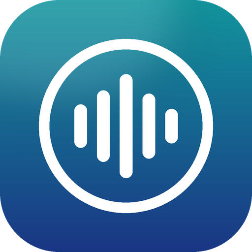
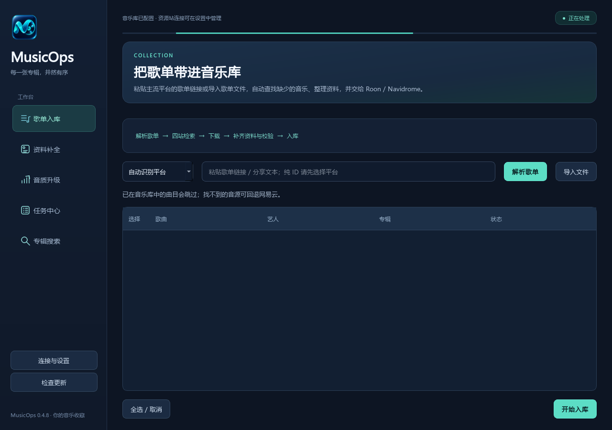

<div align="center">
  
  <h1>MusicOps</h1>
  <p><strong>把歌单变成自己的音乐库，并且一直保持整齐。</strong></p>
  <p>歌单入库 · 资料补全 · 歌词封面 · 音质升级 · 去重合并 · Roon 控制</p>
  <p>
    <a href="https://github.com/wsdbb72/MusicOps/releases/latest"></a>
    <a href="https://github.com/wsdbb72/MusicOps/actions/workflows/native-core.yml"></a>
    <a href="LICENSE"></a>
    
    
    <a href="https://hub.docker.com/r/wsdbb72/muiscops"></a>
  </p>
  <p>
    <a href="https://github.com/wsdbb72/MusicOps/releases/latest"><strong>下载</strong></a> ·
    <a href="docs/用户操作说明.md">操作指南</a> ·
    <a href="docs/运维与恢复说明.md">备份与恢复</a> ·
    <a href="docs/发布说明.md">更新记录</a> ·
    <a href="https://github.com/wsdbb72/MusicOps/issues">反馈</a>
  </p>
</div>



*截图使用合成资料，不含私人账号、歌单或运行档案。*

---

## 它做什么

MusicOps 是一个自托管的音乐库管家：从一个歌单链接开始，找到可用的无损音源，验证、入库、补齐标签与歌词，最后交给 Roon、Plex 或 Navidrome 播放。所有耗时操作都在后台任务里执行，需要人判断的地方集中到「待核对」，不会偷偷改你的文件。

三条主线：

| 场景 | 入口 | 结果 |
| --- | --- | --- |
| **歌单入库** | 粘贴分享链接，勾选“创建入库任务” | 读取曲目名单 → 逐首检索音源 → 验证 → 入库 |
| **资料补全** | 库页「补齐已有歌曲资料」 | 按 MusicBrainz / Discogs 核对，补标签、封面、歌词与 `.lrc` |
| **音质升级** | 库页「检查并自动升级」 | 找到更好的版本后先验证再替换，旧版进入可恢复隔离区 |

## 功能一览

- **歌单**：网易云、QQ 音乐、酷狗、酷我、汽水、咪咕、Apple Music、Spotify、YouTube 的公开歌单读取；也支持 `.m3u` / `.csv` / `.json` / `.xlsx` 等文件导入。订阅后可只把新增曲目自动入库。
- **检索与下载**：RED / DicMusic / Orpheus 三个令牌站共用一套账本（余额、扣费核对、未对账到期），也可加自定义站点；下载交给 qBittorrent，入库前校验 FLAC 头、时长与解码结果。
- **元数据**：MusicBrainz 确认发行身份，Discogs 作为候选（年份、介质、版本）；冲突字段默认保留原值，勾选覆盖才改。支持按专辑目录的**字段锁**与**去重抑制**。
- **歌词与封面**：按 LrcApi 契约接入自建服务；歌词同时写音频标签和同名 `.lrc`，Roon / Plex / Navidrome 都能读。整库可用「补写同名 lrc」把只有标签的曲目补成文件。
- **去重合并**：同名不等于重复；不同发行、母带、声道会保留并给出理由。旧副本进隔离区，可恢复；做种中的文件拒绝合并。
- **整理**：根目录专辑自动整理为「音乐人/专辑」，合作专辑用 `A／B`；多碟保留碟号。
- **Roon**：内嵌扩展，连接后列出播放区、当前曲目，支持播放/暂停/切歌/音量。
- **开放接口**：`/v1/open/*` 配 `X-API-Key`，给脚本或别的软件调用（解析歌单、检索、任务、核对、下载、入库、标签、Roon）。

## 下载与安装

**Windows 10 / 11（x64）**：从 [Releases](https://github.com/wsdbb72/MusicOps/releases/latest) 下载 `MusicOps-x.y.z-Setup.exe` 安装，或解压 `-Windows.zip` 直接运行。安装包自带 FlareSolverr 与 go-music-dl，不需要另装运行环境。

**macOS 15+（Apple Silicon）**：下载 `.dmg` 或 `.pkg`。首次打开若被 Gatekeeper 拦下，在「系统设置 → 隐私与安全性」里允许一次。

**Linux / 服务器**：

```bash
docker run -d --name musicops -p 8080:8080 \
  -e MUSICOPS_APP_PASSWORD='至少16位的密码' \
  -v /srv/musicops:/profile \
  -v /path/to/music:/music \
  wsdbb72/muiscops:latest
```

打开 `http://<主机>:8080`，用用户名 `musicops` 和上面的密码登录。

## 第一次启动

1. 选音乐库目录（Roon 也要添加同一目录）。
2. 导入资源站 Cookie —— 站点页对每个站有“测试登录”，通过再保存。
3. 连接 qBittorrent（地址、用户名、密码），设置分类与标签。
4. 需要歌词封面时填 LrcApi 地址与鉴权；需要目录候选时填 Discogs Token。
5. 可选：Roon 主机与端口（同机 `127.0.0.1:9330`）、Navidrome、Plex。

运行档案在 `profile/`：`state/` 是 Pebble 数据库，`state/native/vault` 是加密凭据，`backup/` 是备份。**密码不在任何地方明文保存**，忘记只能靠备份恢复。

## 任务、队列与核对

- **任务**：所有根任务与它们的阶段（识别、检索、下载、校验、入库），带“进行中 / 待核对 / 已完成”计数。
- **队列**：只看正在执行的任务，每 3 秒刷新；空的时候就是真的没有在跑。
- **核对**：需要人判断的项（发行不唯一、标签冲突、音源不可用）在这里处理，可指定候选、跳过或重试。

任务不会因为一次失败就丢掉；执行器崩溃时完整栈写进 `state/panic.log`（已脱敏），任务行只保留首帧。

## 歌词与播放器兼容

同一份 LRC 文本写两处：音频的 `LYRICS` 标签，以及音频旁边的 `<曲名>.lrc`（如 `01 - Song.flac` → `01 - Song.lrc`）。Roon、Plex、Navidrome 都读后者；只有标签的播放器读前者。

- 已有 `.lrc` 视为“已有歌词”，不勾覆盖不会替换。
- 旧版本写过的 `xxx.flac.lrc` 在读取时仍然兼容，整理或合并时会跟着音频走。
- 库页「补写同名 lrc」可以整库扫描：改名旧文件、按标签补写、已有的一律不动；先点「先看会改多少」只统计不落盘。

## Roon

设置页填写 Roon Core 地址后点「连接 Roon」。程序以 `com.musicops.desktop` 注册为扩展，首次可能需要在 **Roon → 设置 → 扩展** 里启用一次，之后注册码存在加密库里，启动自动重连。

可以列播放区、看当前曲目、播放/暂停/上一首/下一首、按输出调音量。不扫描 Roon 资料库，也不改它的队列。

## 对外接口

`/v1/open/*` 用 `X-API-Key` 鉴权（服务端设置 `MUSICOPS_API_KEY`），与页面同一套数据：

```
GET  /v1/open/info
POST /v1/open/playlists/parse
POST /v1/open/search
GET  /v1/open/jobs/{id}
GET  /v1/open/jobs/{id}/review
POST /v1/open/jobs/{id}/review
POST /v1/open/jobs/{id}/download
POST /v1/open/catalog/identify
POST /v1/open/library/import
GET  /v1/open/library/tags
POST /v1/open/library/tags
GET  /v1/open/roon/status
POST /v1/open/roon/connect | control | disconnect
```

字段与页面一致，错误带 `code`。契约见 `/v1/open` 下的 OpenAPI 说明与 [用户操作说明](docs/用户操作说明.md)。

## 从源码运行

需要 **Go 1.26+**（核心）与 **Python 3.12+**（打包与安装器测试）。

```bash
cd native/core
go test ./...                 # 全量测试
go build ./cmd/musicops       # 核心（HTTP 服务）
go build -tags desktop,production ./cmd/musicops-desktop   # 桌面壳
```

核心需要三个参数：

```bash
./musicops --state-dir ./profile/state/native \
           --backup-dir ./profile/state/native-backup \
           --listen 127.0.0.1:8080
# MUSICOPS_APP_PASSWORD 至少 16 位
```

打包脚本：`packaging/build_windows_go.ps1`（内置引擎 + Inno Setup）、`packaging/build_macos_go.sh`（`.app` / `.pkg` / `.dmg`）。

## 发布

发版由 [desktop-release.yml](.github/workflows/desktop-release.yml) 一次跑完：Windows 安装器与便携包、macOS arm64 三件套、Linux amd64 镜像，全部通过测试与安装验收后才创建 Release，并校验校验和与源码提交。Docker Hub 的 `latest` 只在完整发布后推进。

当前版本：**0.4.40** · 更新内容见 [发布说明](docs/发布说明.md)。

## 已知限制

- 令牌站的 `in-flight` 上限仍为 1，需要多个真实未知扣费同时发生才能验证提高。
- TIDAL / Apple Music / QQ 音乐的回退依赖 go-music-dl（AGPL，不随源码分发，安装包内自带可执行文件）；Roon 之外的音乐服务器只做通知与歌词读取。
- 桌面壳未在真实 macOS 硬件上逐项验收，以 CI 构建产物为准。
- 资料补全的命中率取决于 MusicBrainz 覆盖；流媒体目录只作为候选，不参与身份确认。

## 许可证

源码使用 [MIT 许可证](LICENSE)。第三方依赖与内置服务的许可见 [THIRD-PARTY-NOTICES](packaging/THIRD-PARTY-NOTICES.md)。

感谢 [Playlist Out](https://github.com/LengxiQwQ/playlistout)、[GoMusic](https://github.com/Bistutu/GoMusic)、[node-roon-api](https://github.com/RoonLabs/node-roon-api) 等项目提供的协议与格式参考。
