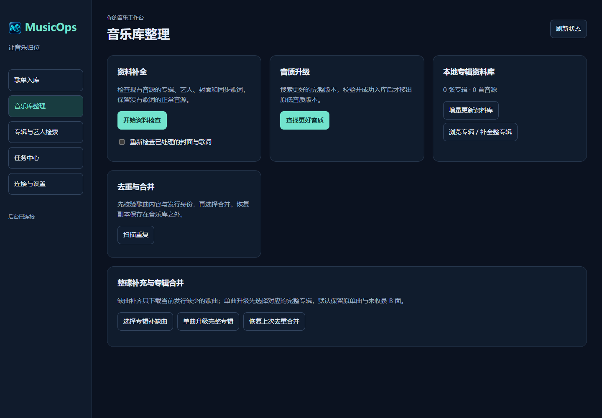

# Linux amd64 Docker 部署

镜像：`wsdbb72/muiscops:latest`（仓库名按最初提供的 **MuiscOps** 转为小写，注意拼写）。仅提供 `linux/amd64`，适合 Intel / AMD 64 位 Linux 设备。

容器的 **8080 端口提供原生 HTML WebUI / HTTP 服务**，电脑和手机浏览器均可访问。页面与桌面版共用同一套后台命令、任务数据库和入库事务，包含歌单入库、四站检索、资料补全、音质升级、任务批量处理及连续核对。浏览器断开不会停止任务，后续版本同步维护两个界面的功能与流程。网页不依赖 VNC、远程桌面或 Qt 窗口。内置 FlareSolverr 在 Linux 上按需使用 Xvfb 执行浏览器验证，这个私有浏览器显示与网页界面无关。



## 安装

宿主机需安装 Docker Engine 和 Compose 插件。下载仓库中的 [compose.yaml](../docker/compose.yaml)，放入一个独立部署文件夹。下面假设当前用户 UID/GID 为 1000；如不同，请同时修改 chown 和启动参数。

```bash
mkdir -p config /srv/music-storage/music /srv/music-storage/MusicOps
sudo chown -R 1000:1000 config /srv/music-storage/MusicOps
# 音乐目录也必须允许该用户读取、创建和整理文件；按原有权限管理，不要盲目更改整库所有者。
PUID=1000 PGID=1000 MUSICOPS_MEDIA=/srv/music-storage docker compose up -d
```

默认仅监听 `127.0.0.1:8080`。本机访问 `http://127.0.0.1:8080`；远程设备可用 SSH 转发：

```bash
ssh -L 8080:127.0.0.1:8080 user@linux设备地址
```

随后在自己电脑打开相同地址。如需局域网访问，可设置 `MUSICOPS_BIND=设备的局域网IP` 再启动，浏览器访问该 IP 的 8080 端口。跨不可信网络使用 HTTPS 反向代理或 SSH 隧道；HTTP Basic 登录本身不加密传输。

登录用户固定为 **musicops**，首次启动生成随机密码，保存在宿主机 `config/web-password`。运行 `cat config/web-password` 查看。密码不会写进日志或镜像。

首次登录从“连接与设置”向导填写 PT 站点 Cookie、qBittorrent、歌词和 AI 等信息；没有的可以跳过。导入的凭据在容器中重新填写，Windows DPAPI/macOS Keychain 文件不能直接移植到 Linux。

## 从旧容器升级

保留同一份 `/config` 和 `/media` 挂载，按下面的更新步骤拉取 `latest`。原网页密码、加密凭据和任务继续使用，端口仍为 8080。首次升级大型历史档案会建立轻量任务摘要，可能需要几十秒；不会清空任务。页面载入失败时先查看容器日志和健康状态。

## 两个持久挂载，避免路径混乱

| 宿主机示例 | 容器中填写的路径 | 用途 |
| --- | --- | --- |
| 当前部署文件夹的 `config` | `/config` | 配置、任务、网页密码和凭据主密钥 |
| `/srv/music-storage/music` | `/media/music` | 最终音乐库 |
| `/srv/music-storage/MusicOps` | `/media/MusicOps` | 下载、整理、备份、隔离及报告 |

**必须挂载共同父目录到 `/media`，不要单独把音乐库和下载目录映射到不同的临时卷。** 默认路径已经按上表设置。临时下载进入 `/media/MusicOps/downloads`，入库时移动到 `/media/music`，沿用既有 qBittorrent 改目录和保种流程。

如果 qBittorrent 也在 Docker 中，给它挂载同一宿主目录，并且同样映射为 `/media`。qBittorrent 返回的下载位置必须能被 MusicOps 原路径访问；不能一边是 `/downloads`，另一边是 `/media/MusicOps/downloads`。容器中的 `127.0.0.1` 只指该容器自身；连接其他容器时用 Docker 网络服务名或宿主机可达 IP。

FFmpeg / ffprobe、go-music-dl 和 FlareSolverr 连同 Chromium 已随镜像提供。后两个服务只在容器内部按需启动；在设置向导启用和测试，凭据仍从 MusicOps 填写。容器只发布原生网页的 8080，不发布后台 IPC 或引擎端口。

## 密码、权限和备份

默认以 UID/GID `1000:1000` 运行，可通过 Compose 的 `PUID`、`PGID` 指定现有用户；不会自动递归修改你的音乐库权限。出现只读/权限错误时，先确认挂载路径属于正确设备并允许该 UID/GID 读写。

网页密码可停机后修改 `config/web-password`，要求 12–256 字符单行文本，文件权限设为 `600`，再启动。也可以挂载只读密码文件并设置 `MUSICOPS_WEB_PASSWORD_FILE`。不要把密码写进仓库。

Linux 凭据采用 AES-GCM 加密；主密钥在 `/config/keys/vault.key`，权限 `600`，与档案分目录保存。**备份整个 `/config`，尤其保留密钥。** 密钥丢失无法恢复旧凭据；同时获得档案和密钥的人能够解密，因此限制宿主机备份与目录访问权限。不要直接复制仍在写入的 SQLite 数据库，先停容器。

```bash
docker compose stop
# 此时备份 config 和需要保留的媒体目录；不要执行 down -v 清理数据卷。
docker compose start
```

## 更新与日志

Compose 默认使用 `latest`，跟随已通过完整发布验收的新版。需要锁定版本时，可把 image 改为 `wsdbb72/muiscops:0.4.22`。保留原来的配置和媒体挂载，执行以下命令更新：

```bash
docker compose pull
docker compose up -d
docker compose logs --tail=100 musicops
```

停止预留 120 秒，先请求后台在安全边界退出；超时后的未完成工作由已有任务恢复机制处理。请勿对正在移动/核验媒体的容器直接强制删除。容器界面的“镜像更新说明”会说明镜像更新步骤，不会运行 Windows/macOS 安装器。

## 构建和发布维护

```bash
docker build --platform linux/amd64 -f docker/Dockerfile -t musicops-local .
```

GitHub Actions 会在原生 Linux amd64 上构建镜像，实际验证网页登录、原生 HTML、受 CSRF 保护的后台命令、后台 IPC、加密凭据重启恢复、媒体默认路径、FFmpeg，以及两个内置服务和 Chromium 的本地页面渲染。验收只使用合成资料，不消费 FL 或下载真实音乐。通过后将**同一个已测试镜像**推到 Docker Hub；Windows/macOS 同提交验收和正式 Release 完成后才推进 `latest`。

仓库 Actions Secret `DOCKERHUB_TOKEN` 保存 Docker Hub 用户 `wsdbb72` 的写入令牌。令牌不进入构建参数、镜像层或源码。镜像保留依赖许可证；系统包许可及对应源码获取说明位于 `/usr/share/doc`，可按 Debian 软件源使用 `apt source` 获取与安装版本对应的源码；引擎对应源码在 `/opt/musicops/engines/licenses/engine-sources.zip`。
